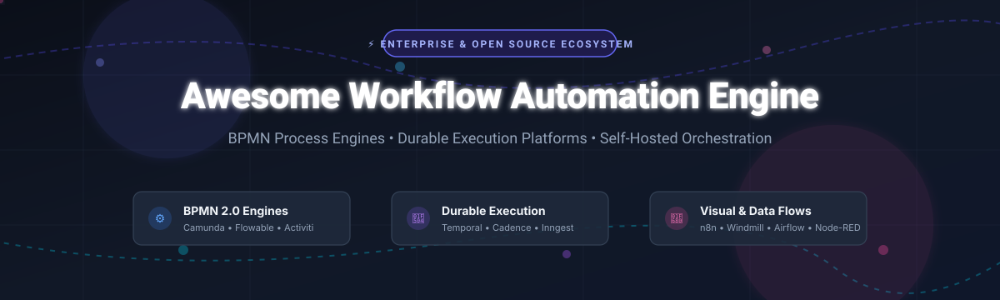
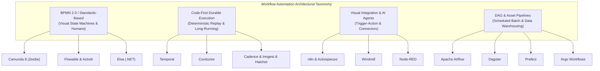

# ⚡ Awesome Workflow Automation Engine

> A curated list of production-grade workflow automation engines, BPMN process orchestrators, durable execution runtimes, and event-driven data flow systems.

<!-- Badges Section -->

  
  
  
  
  
  
  

  <a href="#-sector-overview--market-dynamics">Sector Overview</a> •
  <a href="#-saashosted-platforms">SaaS Platforms</a> •
  <a href="#-open-source-github-projects">Open-Source Engines</a> •
  <a href="#-architectural-taxonomy">Architecture Matrix</a> •
  <a href="#-star-history">Star History</a> •
  <a href="#-contributing">Contributing</a> •
  <a href="#-support">Support</a>

---

## 🧭 Sector Overview & Market Dynamics

The global workflow automation and process orchestration market is valued at approximately **$24.5 billion in 2026** (projected to reach **$45+ billion by 2031** at a ~13.8% CAGR). The sector exhibits **moderate fragmentation with bifurcation**: giant incumbent enterprise platforms (ServiceNow, Atlassian) capture high-value IT service orchestration, while a hyper-competitive, product-led layer (Zapier, Make, Workato) and developer-first durable execution runtimes (Temporal, n8n, Camunda) split developer and departmental adoption without a single winner-take-all outcome.

---

## 🌐 SaaS/Hosted Platforms

The table below catalogs premier commercial workflow automation engines and enterprise integration platforms, sorted in descending order by company scale (valuation or annual enterprise revenue run-rate):

| Company / Product | Scale (Valuation / Revenue) | Starting Tier Pricing | Free Tier / Free Trial Limits | Key Engine Focus |
|:---|:---:|:---:|:---:|:---|
| 🏢 **[ServiceNow Flow Designer](https://www.servicenow.com/)** | **~$200B Market Cap** (~$11B+ Ann. Rev) | **$100 / user / month** (ServiceNow ITSM Pro contract minimum) | **14-day free developer instance (PDI)** with 1 developer sandbox (reclaims on inactivity) | Native enterprise ITIL workflow engine, approval chains, CMDB triggers, and low-code cross-enterprise action flows. |
| 🔷 **[Atlassian Workflow Engine](https://www.atlassian.com/)** | **~$45B Market Cap** (~$4.5B+ Ann. Rev) | **$8.15 / user / month** (Jira Standard tier) | **Free forever plan for up to 10 users**; includes 100 global automation rule executions/month. | Jira native workflow state machine, configurable post-functions, transitions, validators, and no-code automation rules. |
| ⚡ **[Zapier](https://zapier.com/)** | **~$5.0B Valuation** (~$300M+ ARR) | **$19.99 / month** billed annually ($29.99 billed monthly for Starter 750 tasks) | **Free forever plan**: 100 tasks/month, 5 active single-step Zaps, and 15-minute update frequency. | Market-defining consumer and business no-code automation engine with 9,000+ app connectors and multi-step branches. |
| 🧩 **[Make](https://www.make.com/)** | **~$3.0B Valuation** (Acquired by Celonis) | **$9.00 / month** billed annually ($10.59 billed monthly for Core 10,000 ops) | **Free forever plan**: 1,000 operations/month, 100 MB data transfer, and 15-minute minimum execution interval. | Visual graph scenario builder with routers, iterators, aggregators, data manipulation, and execution tracking. |
| 💼 **[Workato](https://www.workato.com/)** | **~$5.7B Valuation** (~$250M+ ARR) | **$10,000 / year base fee + pay-per-recipe** (~$833/month entry contract) | **14-day free trial** with full access to recipe builder, test environment, and standard enterprise connectors. | Enterprise integration & automation platform (iPaaS) with AI copilot recipes, governance, and SOC2/HIPAA compliance. |
| 📑 **[Nintex](https://www.nintex.com/)** | **~$2.0B Valuation** (TPG Private Equity) | **$2,083 / month** billed annually ($25,000/year for Pro tier up to 50 active workflows) | **30-day free trial** with full designer access and unlimited test workflows for up to 30 days. | Process mapping, visual workflow designer, document generation, and enterprise SharePoint/M365 integration. |
| 🔀 **[Camunda SaaS](https://camunda.com/)** | **~$1.2B Valuation** (~$150M+ ARR) | **$99 / month** (Starter plan with 5,000 process instances/month) | **Free forever plan**: 2 active cluster environments, up to 500 process executions/month with community support. | Enterprise cloud BPMN 2.0 and DMN orchestration powered by Zeebe with distributed execution and end-to-end audit trails. |
| 🛠️ **[Tray.io](https://tray.ai/)** | **~$600M Valuation** (~$70M+ ARR) | **$595 / month** (Pro tier base with pooled credits) | **14-day free trial** with full access to Tray Merlin AI builder, workflow builder, and core connectors. | Low-code orchestration platform with enterprise Merlin AI automation, custom connector SDKs, and async error handling. |
| 📈 **[Kissflow](https://kissflow.com/)** | **~$350M Valuation** (~$40M+ ARR) | **$1,500 / month** billed annually (Basic plan for corporate workflows) | **14-day free trial** with access for up to 50 users and all visual form and process designers. | Human-centric digital workplace automation, dynamic approval hierarchies, business process management, and form builders. |
| 🪢 **[n8n Cloud](https://n8n.io/)** | **~$250M Valuation** (~$25M+ ARR) | **€20 / month** billed annually (€24 billed monthly for Starter 2,500 executions) | **14-day free trial of Cloud** (unlimited workflows) or **100% Free Self-Hosted Community Edition** with no execution caps. | Source-available visual automation canvas with JavaScript/Python code execution nodes, AI agent nodes, and 400+ connectors. |

---

## 🔓 Open-Source GitHub Projects

The open-source workflow automation ecosystem is sorted in descending order by **GitHub Stars_Count**:

### 🌟 Ranked Open-Source Repositories

| Repository | GitHub_Stars | License | Core Architecture & Description |
|:---|:---:|:---:|:---|
| 🪢 **[n8n](https://github.com/n8n-io/n8n)** |  | Sustainable Use License (Fair-code) | **Fair-code visual workflow automation platform with native AI agent nodes**. Combine drag-and-drop workflow canvas with inline JavaScript/Python, LangChain/MCP integrations, and 400+ pre-built connectors. |
| 🦅 **[Huginn](https://github.com/huginn/huginn)** |  | MIT | **Autonomous agent orchestration system**. Build personalized web scrapers, automated event monitors, email dispatchers, and multi-agent cascades that read and take actions on the web on your behalf. |
| 🌬️ **[Apache Airflow](https://github.com/apache/airflow)** |  | Apache-2.0 | **The enterprise standard programmatic DAG orchestration engine**. Author, schedule, and monitor data engineering workflows as code in Python with rich plugin ecosystem, SLA monitoring, and massive worker scaling. |
| 🚂 **[Conductor](https://github.com/conductor-oss/conductor)** |  | Apache-2.0 | **Microservices and AI agent orchestration engine originally created by Netflix**. Highly resilient, durable state machine execution engine supporting polyglot workers, event routing, and distributed state persistence. |
| 🧩 **[Activepieces](https://github.com/activepieces/activepieces)** |  | MIT / Commercial | **Open-source no-code workflow automation with MCP support**. Fast TypeScript-based Zapier alternative with 400+ community pieces, AI orchestration, self-hosting via Docker, and human-in-the-loop steps. |
| 🎯 **[Prefect](https://github.com/PrefectHQ/prefect)** |  | Apache-2.0 | **Modern code-first workflow orchestration framework for Python**. Decorate regular functions with `@flow` and `@task` to gain automatic retries, dynamic distributed task mapping, logging, and observability. |
| ⏳ **[Temporal](https://github.com/temporalio/temporal)** |  | MIT | **Industry-leading durable execution runtime**. Write fault-tolerant, stateful long-running workflows as standard code (Go, Java, TypeScript, Python, .NET, PHP) with deterministic replay, timeouts, and saga rollbacks. |
| 🔴 **[Node-RED](https://github.com/node-red/node-red)** |  | Apache-2.0 | **Browser-based flow-driven event engine**. Visual wiring tool for hardware devices, APIs, and online services with thousands of pallet nodes; outstanding for IoT, real-time message brokers, and event pipelines. |
| 💨 **[Windmill](https://github.com/windmill-labs/windmill)** |  | AGPL-3.0 / Commercial | **Extremely fast developer-first workflow engine and internal app builder**. Build distributed flows, endpoints, and UIs in TypeScript, Python, and Go with instant execution, auto-generated forms, and low resource overhead. |
| 🐙 **[Argo Workflows](https://github.com/argoproj/argo-workflows)** |  | Apache-2.0 | **Kubernetes-native workflow engine**. Implemented as a Kubernetes CRD to orchestrate parallel jobs, compute-intensive ML pipelines, and CI/CD steps where each task executes in its own container pod. |
| 📊 **[Dagster](https://github.com/dagster-io/dagster)** |  | Apache-2.0 | **Data-aware orchestrator focused on software-defined assets**. Combines workflow dependencies with asset tracking, testing, and built-in lineage visualization across modern data stacks. |
| ⚡ **[Activiti](https://github.com/Activiti/Activiti)** |  | Apache-2.0 | **Lightweight, battle-tested BPMN 2.0 process engine for Java**. Embeddable inside Spring Boot applications or scalable on Kubernetes with Cloud-native microservices architecture and standard BPMN execution. |
| 🌊 **[Flowable](https://github.com/flowable/flowable-engine)** |  | Apache-2.0 | **Permissively-licensed BPMN 2, CMMN 1.1, and DMN 1.2 business process engine**. Exceptional Spring Boot compatibility, lightning-fast relational database execution, and native human task orchestration. |
| 🛡️ **[Cadence](https://github.com/cadence-workflow/cadence)** |  | Apache-2.0 | **Uber's battle-tested durable distributed workflow orchestrator**. Original architectural predecessor of Temporal, providing fault-tolerant stateful execution across heterogeneous microservice networks. |
| 🪓 **[Hatchet](https://github.com/hatchet-dev/hatchet)** |  | MIT | **Distributed background task & durable workflow orchestrator**. Designed for low latency, rate limiting, concurrency controls, and complex workflows for modern AI pipelines and microservices in Go, Python, and TypeScript. |
| ❄️ **[Elsa Workflows](https://github.com/elsa-workflows/elsa-core)** |  | MIT | **Premier open-source workflow library for .NET**. Visual studio workflow builder, long-running state management with bookmarks, HTTP triggers, cron schedules, and programmatic C# workflow definitions. |
| ⚡ **[Inngest](https://github.com/inngest/inngest)** |  | BSL 1.1 / Apache-2.0 | **Event-driven durable execution engine for serverless and edge environments**. Step functions, retries, sleep-for-days, and AI function chaining without setting up infrastructure or worker queues. |
| ⚙️ **[Camunda (Zeebe)](https://github.com/camunda/camunda)** |  | Zeebe Community License / BSL | **High-throughput, distributed cloud-native BPMN 2.0 orchestration engine**. Powers Camunda Platform 8 with append-only Raft consensus, zero relational database dependency, and linear horizontal scaling. |

---

## 🏛️ Architectural Taxonomy

Understanding the technical trade-offs between different workflow engines:

---

## 📈 Star History

---

## 🤝 Contributing

Contributions, new engine submissions, and corrections are warmly welcomed!

1. 🍴 **Fork the repository**
2. 🌿 **Create your branch**: `git checkout -b feature/add-new-workflow-engine`
3. ✍️ **Add entry to `README.md`**: Follow the established table schemas (pricing details, free limits, or Stars_Badges)
4. 🚀 **Submit a Pull Request** with a concise description of why this engine should be included

Explore our master collection at [Awesome-Awesome-Awesome](https://github.com/ishandutta2007/Awesome-Awesome-Awesome).

---

## ☕ Support

If you found this curated ecosystem map helpful for evaluating your organization's workflow automation or durable execution stack, please consider supporting the project!

- ⭐ **Star this repository** to improve discoverability
- 🍴 **Fork and share** with fellow architects and platform engineers
- ☕ **Sponsor or buy a coffee**: [Sponsor ishandutta2007 on GitHub Sponsors](https://github.com/sponsors/ishandutta2007)

Thank you for being part of the open-source automation community! 💖

---

## 📜 Disclaimer

- This curated list is maintained for architectural research and community reference. Product names, logos, and brands belong to their respective copyright holders.
- Pricing metrics, valuations, and free tier limits reflect published terms and enterprise benchmarks as of late 2026 and are subject to change by vendors.
- Workflow automation engines process business-critical logic and sensitive credentials; ensure proper secret management, RBAC, and encryption are configured before production deployment.

---

  <b>Built with ❤️ for platform engineers, architects, and automation developers worldwide.</b>

